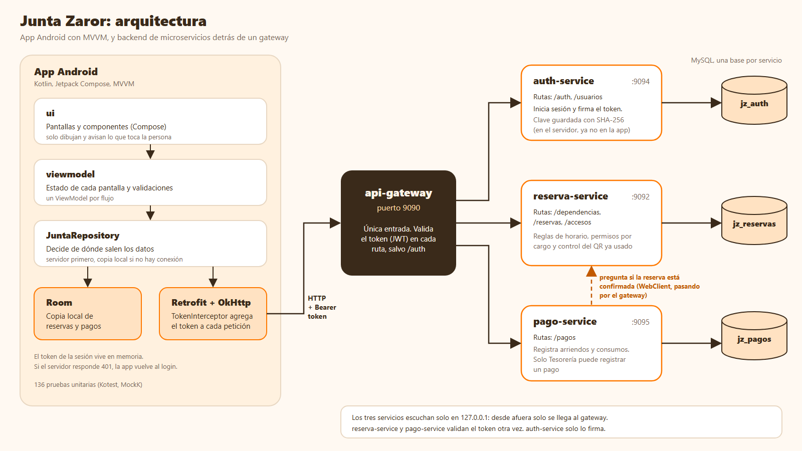

# Junta Zaror: backend

Backend de microservicios de la app [AppJuntaVecinos](https://github.com/PabloRico25/AppJuntaVecinos). Administra las reservas de las salas de la Junta de Vecinos Población Zaror, sus pagos y las sesiones de la directiva. El caso es ficticio y todos los datos son de ejemplo.

| | |
|---|---|
| Asignatura | DSY1105 Desarrollo de Aplicaciones Móviles, Duoc UC |
| Evaluación | Parcial 4 |
| Integrantes | Pablo Alexander Rico Rodríguez, William Martín Rodríguez Troncoso |
| Pila | Java 21, Spring Boot 4.0.5, Spring Cloud Gateway, Spring Security, JPA con MySQL, JWT |

## Arquitectura



- La app solo habla con el gateway. Los tres servicios escuchan en `127.0.0.1`, así que desde otro aparato no se llega a ellos directamente.
- El gateway valida el token en cada ruta, salvo las de `/auth` y la lectura de `GET /dependencias`. `reserva-service` y `pago-service` lo validan otra vez con la misma clave, para no depender de que alguien más haya revisado antes. `auth-service` es quien firma los tokens y confía en el gateway: no valida ninguno, y por eso solo escucha en `127.0.0.1`.
- Cada servicio tiene su propia base de datos (`jz_auth`, `jz_reservas`, `jz_pagos`). `pago-service` pregunta a `reserva-service` si una reserva está confirmada antes de aceptar un pago de arriendo. Esa llamada va con `WebClient` por el gateway, como en el ejemplo del docente.
- Capas de cada servicio: `controller`, `service`, `repository`, `model`, `dto`, `exception` y `config`. Un `DataLoader` carga los datos de ejemplo la primera vez.

### Equivalencia con la propuesta técnica

| Propuesta del docente | Aquí |
|---|---|
| `ms-admin` (usuarios y roles) | `auth-service` |
| `ms-reservas` | `reserva-service` |
| `ms-finanzas` | `pago-service` |
| API Gateway | `api-gateway` |

Se mantuvieron los nombres del ejemplo de código del docente. La propuesta dice que los nombres y los atributos pueden ajustarse. Lo que no se implementó está en la sección Alcance y limitaciones.

## Endpoints

Todos salen por `http://<equipo>:9090`. Las respuestas son JSON y llevan `Authorization: Bearer <token>`, salvo el login. El detalle de cada cuerpo, de cada regla y de cada mensaje de error está en [CONTRATO_API.md](CONTRATO_API.md), el acuerdo entre la app y el backend.

### auth-service

| Método y ruta | Quién | Qué hace |
|---|---|---|
| `POST /auth/login` | Cualquiera | Entra con correo y clave. Responde `{ token, usuario }`. Con `"dispositivo": "PUERTA"` solo entra la directiva y el token dura 7 días |
| `GET /usuarios` | Cualquier sesión | Lista de usuarios, sin la clave |

### reserva-service

| Método y ruta | Quién | Qué hace |
|---|---|---|
| `GET /dependencias` | Cualquiera, **sin token** | Las dos salas. Es la única ruta pública además del login: un aparato que va a ser la puerta las necesita antes de que alguien inicie sesión en él |
| `GET /reservas` | Cualquier sesión | El vecino recibe las suyas y la directiva todas. Filtro opcional `?estado=` |
| `GET /reservas/{id}` | Dueño o directiva | Una reserva |
| `POST /reservas` | Vecino | Crea una reserva pendiente. Valida fecha, horas y choque con una reserva confirmada |
| `PUT /reservas/{id}/cancelar` | Dueño | Cancela, solo si está pendiente |
| `PUT /reservas/{id}/confirmar` | Secretaría | Confirma, solo si está pendiente. Vuelve a revisar el choque de horario |
| `PUT /reservas/{id}/rechazar` | Secretaría | Rechaza, solo si está pendiente |
| `GET /reservas/ocupacion?dependenciaId=&fecha=` | Cualquier sesión | Bloques ocupados de una sala y un día. Los nombres solo los ve la directiva |
| `GET /reservas/{id}/confirmada` | Otro servicio | Dice si la reserva existe y está confirmada |
| `GET /accesos/usadas` | Directiva o puerta | Reservas cuyo QR ya se usó |
| `POST /accesos` | Directiva o puerta | Registra un ingreso. Un mismo QR no entra dos veces (409) |

### pago-service

| Método y ruta | Quién | Qué hace |
|---|---|---|
| `GET /pagos` | Cualquier sesión | Pagos, el más nuevo primero. Al vecino no se le entregan la reserva, el comprobante ni quién lo registró |
| `GET /pagos/pagadas` | Cualquier sesión | Reservas que ya tienen su pago de arriendo |
| `POST /pagos` | Tesorería | Registra un pago de arriendo o de un consumo básico |

### Códigos de respuesta

| Código | Cuándo |
|---|---|
| 200 y 201 | Lectura o actualización correcta, y creación correcta |
| 400 | Datos inválidos: falta un campo, fecha pasada, monto 0 |
| 401 | Sin token, token vencido o clave incorrecta |
| 403 | La persona no tiene el cargo para hacer eso |
| 404 | No existe, o no es suya |
| 409 | Choca con otra regla: horario ocupado, reserva ya pagada, QR ya usado, estado que no lo permite |

Los errores tienen el mismo cuerpo en los tres servicios: `timestamp`, `status`, `error`, `message` y `path`. La app muestra el `message` tal cual.

## Cómo ejecutarlo

Requisitos: Java 21, MySQL en el puerto 3306 y un usuario `jz_user` con permiso sobre las tres bases.

1. Crear, en la carpeta de cada servicio, un archivo `.env` con la clave del JWT y la contraseña de MySQL. Ese archivo no se sube al repositorio. La misma clave debe estar en los cuatro `.env`.
2. Encender todo: `.\levantar.ps1`. Enciende MySQL y los cuatro servicios, y escribe sus mensajes en `logs\`.
3. Apagar los servicios: `.\parar.ps1`.
4. Volver a los datos de ejemplo: `.\reiniciar-datos.ps1`.

Desde el emulador de Android el gateway es `http://10.0.2.2:9090`. Desde un teléfono real es la IP del computador en la red local.

**Usuarios de prueba.** La clave de todos es `1234`.

| Correo | Rol |
|---|---|
| juan.perez@zaror.test, ana.munoz@zaror.test, pedro.soto@zaror.test | Vecino |
| maria.torres@zaror.test | Directiva, Secretaría |
| luis.rojas@zaror.test | Directiva, Tesorería |
| carmen.vidal@zaror.test | Directiva, Presidencia |

## Pruebas

68 pruebas automáticas: 45 en `reserva-service` y 23 en `pago-service`, entre servicio (Mockito) y controlador (`MockMvc`). Cubren las reglas de negocio, los permisos por cargo, los códigos de error, el control del QR repetido y la llamada de `pago-service` a `reserva-service`.

```
cd reserva-service
.\mvnw.cmd test
```

`auth-service` y `api-gateway` no tienen pruebas automáticas: se probaron a mano con Postman y con la app.

## Alcance y limitaciones

- **Datos y claves.** Todo es ficticio. La clave se guarda con hash SHA-256. La app la envía sin cifrar por la red local de desarrollo, y en un uso real iría sobre HTTPS.
- **Tablas de la propuesta no creadas.** No existen `historial_reserva`, `categoria_movimiento`, `comprobante`, `informe_financiero` ni `rol`. Quién gestionó una reserva se guarda en la propia reserva, la categoría del pago es un texto y el rol y el cargo del usuario también. `historial_reserva` es lo primero que se sumaría.
- **Comprobantes.** El servidor guarda solo la referencia que envía la app. La imagen no se sube al servidor.
- **Notificaciones.** El servidor no las envía. La app avisa dentro de la pantalla.
- **Sin conexión.** La app guarda una copia local de lo último que descargó, pero no encola operaciones para enviarlas después.
- **Docker.** Hay `Dockerfile` solo para `api-gateway` y `auth-service`, y no se ejecutan: el backend se enciende con los scripts de PowerShell.
- **QR.** La firma del QR se genera y se comprueba dentro de la app. El servidor solo recuerda qué QR ya se usó.
