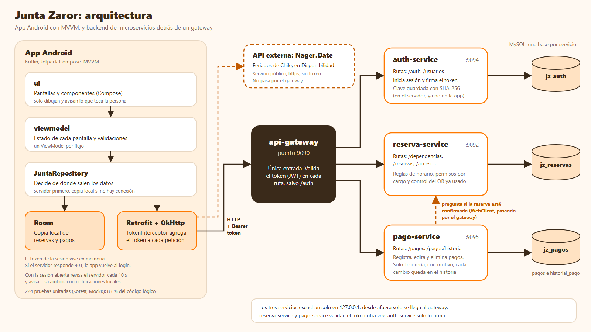

# Junta Zaror: backend

Backend de microservicios de la app [AppJuntaVecinos](https://github.com/PabloRico25/AppJuntaVecinos). Administra las reservas de las salas de la Junta de Vecinos Población Zaror, sus pagos y las sesiones de la directiva. El caso es ficticio y todos los datos son de ejemplo.

| | |
|---|---|
| Asignatura | DSY1105 Desarrollo de Aplicaciones Móviles, Duoc UC |
| Evaluación | Parcial 4 (encargo) y Parcial 5 (defensa) |
| Integrantes | Pablo Alexander Rico Rodríguez, William Martín Rodríguez Troncoso |
| Pila | Java 21, Spring Boot 4.0.5 (el gateway, 3.3.5, como en el ejemplo del docente), Spring Cloud Gateway, Spring Security, JPA con MySQL, JWT |

## Arquitectura



- La app solo habla con el gateway. Los tres servicios escuchan en `127.0.0.1`, así que desde otro aparato no se llega a ellos directamente.
- El gateway valida el token en cada ruta, salvo las de `/auth` y la lectura de `GET /dependencias`. `reserva-service` y `pago-service` lo validan otra vez con la misma clave, para no depender de que alguien más haya revisado antes. `auth-service` es quien firma los tokens y confía en el gateway: no valida ninguno, y por eso solo escucha en `127.0.0.1`.
- Cada servicio tiene su propia base de datos (`jz_auth`, `jz_reservas`, `jz_pagos`). `pago-service` pregunta a `reserva-service` si una reserva está confirmada antes de aceptar un pago de arriendo. Esa llamada va con `WebClient` por el gateway, como en el ejemplo del docente.
- Capas de cada servicio: `controller`, `service`, `repository`, `model`, `dto`, `exception` y `config`. Un `DataLoader` carga los datos de ejemplo la primera vez.

### Equivalencia con la propuesta técnica

| Propuesta del docente | Aquí |
|---|---|
| `ms-admin` (usuarios y roles) | `auth-service` |
| `ms-reservas` | `reserva-service` |
| `ms-finanzas` | `pago-service` |
| API Gateway | `api-gateway` |

Se mantuvieron los nombres del ejemplo de código del docente. La propuesta dice que los nombres y los atributos pueden ajustarse. Lo que no se implementó está en la sección Alcance y limitaciones.

## Modelo de datos

Cada servicio es dueño de sus tablas y ninguno lee las de otro: `pago-service` pregunta por la reserva a `reserva-service`, no a su base. Las tablas las crea JPA al arrancar (`ddl-auto=update`).

| Base | Tabla (entidad) | Campos | Para qué |
|---|---|---|---|
| `jz_auth` | `Usuario` | id, nombre, correo, clave (hash SHA-256), rol, cargo | Las cuentas. El rol es VECINO o DIRECTIVA; el cargo, SECRETARIA, TESORERIA o PRESIDENCIA |
| `jz_reservas` | `Dependencia` | id, nombre | Las salas: Salón Principal y Sala Multiuso |
| `jz_reservas` | `Reserva` | id, dependenciaId, vecinoId, fecha, horaInicio, horaFin, estado, fechaSolicitud, gestionadaPorId | Las solicitudes y su estado: PENDIENTE, CONFIRMADA, RECHAZADA o CANCELADA |
| `jz_reservas` | `Acceso` | reservaId, fecha, hora | Los QR que ya entraron por la puerta. reservaId es la clave: un QR no entra dos veces |
| `jz_pagos` | `Pago` | id, reservaId, tipo, categoria, monto, fecha, comprobanteUri, registradoPorId, descripcion | Arriendos y consumos básicos. reservaId es único: un arriendo no se paga dos veces |
| `jz_pagos` | `HistorialPago` | id, pagoId, accion, tipo, categoria, montoAnterior, montoNuevo, fechaPago, motivo, cargo, usuarioId, fechaHora | Cada pago registrado, editado o eliminado. Lo escribe solo el servidor y no hay ruta para cambiarlo |

Las fechas viajan y se guardan como texto año-mes-día y las horas como `HH:00`, así se comparan y ordenan como texto.

## Qué viene del ejemplo del docente y qué es nuestro

El ejemplo de referencia es `Microservicios-Docker-Con-JWT`, que se vio en clase.

| Pieza | Origen |
|---|---|
| Gateway con Spring Cloud Gateway que reparte por ruta | Ejemplo del docente |
| Login que firma un JWT con jjwt, y validación del JWT con `oauth2-resource-server` | Ejemplo del docente |
| Capas `controller`, `service`, `repository`, `model`, `dto`, `exception` y `config`, y un `DataLoader` | Ejemplo del docente |
| Un servicio que llama a otro con `WebClient` | Ejemplo del docente (`pago-service` y `compra-service`) |
| Cuerpo de error `timestamp`, `status`, `error`, `message`, `path` | Ejemplo del docente |
| JPA con MySQL, Lombok y pruebas con JUnit 5, Mockito y `MockMvc` | Ejemplo del docente |
| Clave con hash | El ejemplo usa SHA-1; aquí, SHA-256 |
| Permisos por rol y cargo leídos del token (`@AuthenticationPrincipal Jwt`) | Nuestro: el token del ejemplo solo lleva el correo |
| `ResponseStatusException` con un manejador central | Nuestro: el ejemplo usa una excepción propia por tipo. El cuerpo del error es el mismo |
| Servicios que escuchan solo en `127.0.0.1` y claves en un `.env` | Nuestro: el ejemplo deja la clave del JWT escrita en el código |
| Reglas de reserva, de pago, del QR usado y el historial de pagos con motivo | Nuestro: es la lógica del caso |
| Scripts de PowerShell para encender y apagar | Nuestro: el ejemplo se enciende con Docker |

Del ejemplo no se usaron Docker Compose, Liquibase, Swagger, HATEOAS, Actuator, Datafaker, `@Valid` ni los DTO de respuesta: el caso no los necesitaba. Hay `Dockerfile` para `api-gateway` y `auth-service`, copiados del ejemplo, que no se ejecutan.

## Endpoints

Todos salen por `http://<equipo>:9090`. Las respuestas son JSON y llevan `Authorization: Bearer <token>`, salvo el login. El detalle de cada cuerpo, de cada regla y de cada mensaje de error está en [CONTRATO_API.md](CONTRATO_API.md), el acuerdo entre la app y el backend.

### auth-service

| Método y ruta | Quién | Qué hace |
|---|---|---|
| `POST /auth/login` | Cualquiera | Entra con correo y clave. Responde `{ token, usuario }`. Con `"dispositivo": "PUERTA"` solo entra la directiva y el token dura 7 días |
| `GET /usuarios` | Cualquier sesión | Lista de usuarios con nombre, rol y cargo. Sin la clave y sin el correo (va vacío): un vecino no necesita el correo de los demás |

### reserva-service

| Método y ruta | Quién | Qué hace |
|---|---|---|
| `GET /dependencias` | Cualquiera, **sin token** | Las dos salas. Es la única ruta pública además del login: un aparato que va a ser la puerta las necesita antes de que alguien inicie sesión en él |
| `GET /reservas` | Cualquier sesión | El vecino recibe las suyas y la directiva todas. Filtro opcional `?estado=` |
| `GET /reservas/{id}` | Dueño o directiva | Una reserva |
| `POST /reservas` | Vecino | Crea una reserva pendiente. Valida fecha, horas y choque con una reserva confirmada |
| `PUT /reservas/{id}/cancelar` | Dueño | Cancela, solo si está pendiente |
| `PUT /reservas/{id}/confirmar` | Secretaría | Confirma, solo si está pendiente. Vuelve a revisar el choque de horario |
| `PUT /reservas/{id}/rechazar` | Secretaría | Rechaza, solo si está pendiente |
| `GET /reservas/ocupacion?dependenciaId=&fecha=` | Cualquier sesión | Bloques ocupados de una sala y un día. Los nombres solo los ve la directiva |
| `GET /reservas/{id}/confirmada` | Otro servicio | Dice si la reserva existe y está confirmada |
| `GET /accesos/usadas` | Directiva o puerta | Reservas cuyo QR ya se usó |
| `POST /accesos` | Directiva o puerta | Registra un ingreso. Un mismo QR no entra dos veces (409) |

### pago-service

| Método y ruta | Quién | Qué hace |
|---|---|---|
| `GET /pagos` | Cualquier sesión | Pagos, el más nuevo primero. Al vecino no se le entregan la reserva, el comprobante ni quién lo registró |
| `GET /pagos/pagadas` | Cualquier sesión | Reservas que ya tienen su pago de arriendo |
| `POST /pagos` | Tesorería | Registra un pago de arriendo o de un consumo básico |
| `GET /pagos/{id}` | Cualquier sesión | Un pago. Al vecino le llega sin lo privado, como en la lista |
| `PUT /pagos/{id}` | Tesorería | Corrige el monto, la fecha, la descripción y, en un consumo, la categoría. El tipo y la reserva no cambian. Exige `motivo` (10 a 200 letras) |
| `DELETE /pagos/{id}?motivo=...` | Tesorería | Elimina un pago mal registrado (204). Si era un arriendo, la reserva vuelve a quedar por cobrar. Exige el motivo |
| `GET /pagos/historial` | Cualquier sesión | Cada pago registrado, editado o eliminado, con el monto anterior y el nuevo, el motivo y el cargo de quien lo hizo. Nadie puede editarlo ni borrarlo. Al vecino no le llega el id de la persona |

### Códigos de respuesta

| Código | Cuándo |
|---|---|
| 200 y 201 | Lectura o actualización correcta, y creación correcta |
| 400 | Datos inválidos: falta un campo, fecha pasada, monto 0 |
| 401 | Sin token, token vencido o clave incorrecta |
| 403 | La persona no tiene el cargo para hacer eso |
| 404 | No existe, o no es suya |
| 409 | Choca con otra regla: horario ocupado, reserva ya pagada, QR ya usado, estado que no lo permite |

Los errores tienen el mismo cuerpo en los tres servicios: `timestamp`, `status`, `error`, `message` y `path`. La app muestra el `message` tal cual.

## Cómo ejecutarlo

Requisitos: Java 21, MySQL en el puerto 3306 y un usuario `jz_user` con permiso sobre las tres bases.

1. Crear, en la carpeta de cada servicio, un archivo `.env` con la clave del JWT y la contraseña de MySQL. Ese archivo no se sube al repositorio. La misma clave debe estar en los cuatro `.env`.
2. Encender todo: `.\levantar.ps1`. Enciende MySQL y los cuatro servicios, y escribe sus mensajes en `logs\`.
3. Apagar los servicios: `.\parar.ps1`.
4. Volver a los datos de ejemplo: `.\reiniciar-datos.ps1`.

Desde el emulador de Android el gateway es `http://10.0.2.2:9090`. Desde un teléfono real es la IP del computador en la red local o, en la presentación, su IP de Tailscale (ver [Operación y presentación](#operación-y-presentación)).

**Usuarios de prueba.** La clave de todos es `1234`.

| Correo | Rol |
|---|---|
| juan.perez@zaror.test, ana.munoz@zaror.test, pedro.soto@zaror.test | Vecino |
| maria.torres@zaror.test | Directiva, Secretaría |
| luis.rojas@zaror.test | Directiva, Tesorería |
| carmen.vidal@zaror.test | Directiva, Presidencia |

## Operación y presentación

### Scripts

Se corren desde la carpeta del backend, con `powershell -ExecutionPolicy Bypass -File .\<script>` si la política de PowerShell no deja correrlos directamente.

| Script | Qué hace |
|---|---|
| `levantar.ps1` | Enciende MySQL y los cuatro servicios, uno tras otro, y espera a que cada uno abra su puerto. Se puede correr varias veces: lo que ya está encendido se deja como está. Los mensajes van a `logs\<servicio>.log` |
| `parar.ps1` | Apaga los cuatro servicios por su puerto. Deja MySQL encendido; con `-ConMySQL` lo apaga también |
| `reiniciar-datos.ps1` | Deja las bases con los datos de ejemplo recién cargados. Apaga los servicios, borra las tablas de reservas, accesos, pagos e historial de pagos, y vuelve a encender todo: cada `DataLoader` las llena de nuevo con fechas calculadas a partir de hoy. Los usuarios no se tocan. Pide la clave de `root` de MySQL |

Puertos: gateway 9090, `reserva-service` 9092, `auth-service` 9094, `pago-service` 9095 y MySQL 3306.

### Acceso desde otros aparatos

En la presentación el backend corre en un notebook y los teléfonos lo alcanzan por Tailscale, con la IP `100.65.13.28`, que no cambia con la red. Dos cosas lo permiten y lo limitan:

- **Firewall de Windows.** Una regla de entrada deja pasar el puerto 9090 solo desde el rango de Tailscale (`100.64.0.0/10`). Se crea una vez, en PowerShell como administrador:

  ```
  New-NetFirewallRule -DisplayName "Junta Zaror gateway 9090 (Tailscale)" -Direction Inbound -Protocol TCP -LocalPort 9090 -RemoteAddress 100.64.0.0/10 -Action Allow
  ```

  Los otros tres servicios no necesitan regla: escuchan solo en `127.0.0.1`.
- **Política de acceso de Tailscale.** Cada aparato necesita Tailscale y un permiso en la política de la cuenta para llegar al notebook solo por el puerto TCP 9090. Lo que no está permitido ahí queda bloqueado.

Para comprobar que todo el camino funciona, desde el navegador de un aparato conectado a Tailscale se abre `http://100.65.13.28:9090/dependencias`. Debe devolver las dos salas, porque esa ruta no pide token.

La app se compila con esa dirección en `urlServidor`: ver el [README de la app](https://github.com/PabloRico25/AppJuntaVecinos). La sesión de una persona dura 12 horas y la de una puerta, 7 días.

## Pruebas

87 pruebas automáticas: 45 en `reserva-service`, 41 en `pago-service` y 1 en `auth-service`. En los dos primeros hay pruebas del servicio (Mockito) y del controlador (`MockMvc`, con un `Jwt` de prueba). Cubren las reglas de negocio, los permisos por cargo, los códigos de error, el control del QR repetido, la llamada de `pago-service` a `reserva-service`, la edición y eliminación de pagos con motivo y el historial.

```
cd reserva-service
.\mvnw.cmd test
```

`auth-service` solo tiene la prueba de arranque de la plantilla, y `api-gateway` ninguna: se probaron a mano con Postman y con la app.

## Alcance y limitaciones

- **Datos y claves.** Todo es ficticio. La clave se guarda con hash SHA-256. La app la envía sin cifrar por la red local de desarrollo, y en un uso real iría sobre HTTPS.
- **Tablas de la propuesta.** Existe el historial de pagos (`HistorialPago`). No existen `historial_reserva`, `categoria_movimiento`, `comprobante`, `informe_financiero` ni `rol`: quién gestionó una reserva se guarda en la propia reserva, la categoría del pago es un texto y el rol y el cargo del usuario también. `historial_reserva` es lo primero que se sumaría.
- **Comprobantes.** El servidor guarda solo la referencia que envía la app. La imagen no se sube al servidor.
- **Notificaciones.** El servidor no envía notificaciones push. La app lo consulta cada 10 segundos con la sesión abierta y muestra notificaciones locales. El historial de pagos sí queda guardado en el servidor.
- **Token de la puerta.** Dura 7 días y lleva los mismos permisos de la cuenta de la directiva que la activó. Para un uso real debería servir solo para registrar ingresos.
- **Sin conexión.** La app guarda una copia local de lo último que descargó, pero no encola operaciones para enviarlas después.
- **Disponibilidad.** Todo corre en un solo equipo. Si ese equipo se apaga o pierde la conexión, la app muestra lo último que descargó, pero no puede pedir, confirmar ni pagar nada.
- **Docker.** Hay `Dockerfile` solo para `api-gateway` y `auth-service`, y no se ejecutan: el backend se enciende con los scripts de PowerShell.
- **QR.** La firma del QR se genera y se comprueba dentro de la app. El servidor solo recuerda qué QR ya se usó: no se revisa de nuevo si el pago sigue registrado.
